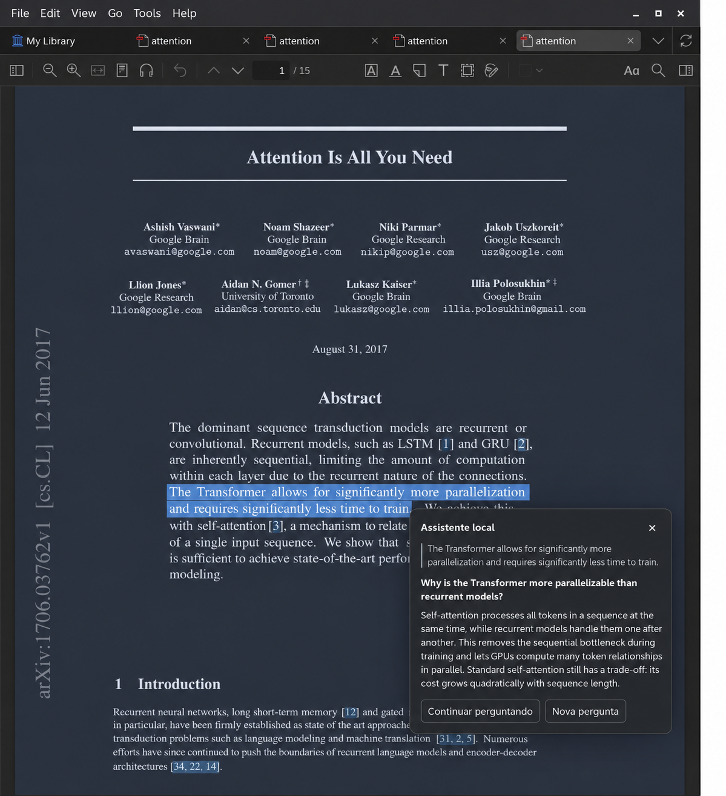

# Zotero Reader Local AI

**English** | [Português (Brasil)](README.pt-BR.md)

A Zotero add-on that helps readers understand PDF passages and ask questions about a paper using locally run language models.



## Features

- Explain selected passages and ask questions about a PDF.
- View assistance alongside the text and optionally save useful answers as Zotero annotations.
- Read formatted Markdown and mathematical expressions.
- Answers follow the language of each question automatically, with no separate language setting.
- Uses local RAG by default: only the most relevant article excerpts are sent to the model, using Qwen3-Embedding-0.6B. The **Full article** mode remains available.
- Inference runs locally by default; an optional Groq provider can be configured with your own API key.
- Conversations are not saved automatically.

## Compatibility

- Zotero 10.0.3–10.0.x. The current stable release, 10.0.6, and the 10.0.3 floor are covered by native activation, interface and managed-runtime evidence on Linux.
- The bundled runtime and in-app server controls are validated on Linux x86_64 with Python 3.12 or newer. Windows 10 22H2 and Windows 11 x64 support is implemented, but native acceptance on Windows is still pending. macOS, Windows ARM64 and 32-bit Windows are not supported.
- An NVIDIA GPU is optional. Linux uses CUDA 12.8; Windows uses CUDA 12.4 with driver 551.61 or newer. Automatic mode can use the GPU, share work between GPU and CPU, or fall back to CPU.

## Get started

1. Download the `.xpi` package from [Releases](https://github.com/felipebocajr/zotero-reader-local-ai/releases).
2. Clone the project and prepare the runtime, the default chat model (LFM2.5-8B-A1B, Q4_K_M) and the embedding model (Qwen3-Embedding-0.6B, Q8_0):

   Linux:

   ```bash
   git clone https://github.com/felipebocajr/zotero-reader-local-ai.git
   cd zotero-reader-local-ai
   python3 scripts/setup_runtime.py --backend auto --precision Q4_K_M
   ```

   Windows (PowerShell, 64-bit Python 3.12 or newer):

   ```powershell
   git clone https://github.com/felipebocajr/zotero-reader-local-ai.git
   cd zotero-reader-local-ai
   py -3 scripts\setup_runtime.py --backend auto --precision Q4_K_M
   ```

   This step downloads the required files, including the 639 MB embedding model, and needs an internet connection and disk space. Inference can run offline after setup. Use `--backend cpu` to skip the CUDA download when starting the server manually with `--backend cpu`; the in-app control expects the automatic GPU and CPU runtimes.

3. In Zotero, open the Plugins menu, choose **Install Plugin From File** from the gear menu, and select the `.xpi`.
4. In the **Assistente local** (Local Assistant) preferences pane, choose the cloned project folder and click **Iniciar servidor** (Start Server). When the status is **Pronto** (Ready), open a PDF, select a passage, and choose **Explicar trecho** (Explain Passage) or **Fazer pergunta** (Ask a Question). The first explanation is brief; choose **Explicar com mais detalhes** (Explain in More Detail) after it for a deeper answer. Use **Expandir** (Expand) in the popup header to enlarge the popup and **Restaurar** (Restore) to return to the default size; drag the header to move the popup and the bottom-right corner to resize it freely.

The default model is LFM2.5-8B-A1B. To use LFM3-1.7B or configure the runtime, see the [runtime guide](docs/runtime.md). The legacy LFM2.5-2.6B remains only for the delivered benchmark and is not offered in the plugin. Plugin updates are manual.

### Providers

- **Local server (default):** uses this project's `llama-server`, with exact template token counting and offline inference after setup.
- **Groq (API):** uses your own `gsk_...` key, the selected model and the configured context. In the default mode, only the retrieved excerpts, selected passage and question are sent to Groq over the internet; embeddings stay local. The full article is sent only if you choose **Full article** under **Context sent**. In this prototype the key is stored in Zotero preferences as plain text; use a key with a usage limit.

To switch providers, open **Settings → Assistente local**, choose **Groq (API)**, paste the key and press **Enter** to load the models. Choose a model from the list and click **Salvar configurações** (Save Settings). There is no local server to start in this mode.

## Privacy and limitations

By default, inference and embeddings run on your device. If you select **Groq (API)**, only the retrieved excerpts, selected passage and question are sent to Groq; this happens only after that explicit choice. The full article goes to Groq only in the explicitly selected **Full article** mode. In this prototype the key is stored in Zotero preferences as plain text. Initial setup downloads the runtime and model files. Scanned PDFs without selectable text need OCR, which is not included. Answers may contain errors; see the [evaluation and its limitations](experiments/report.md).

## Development

Requires Node.js 22.18 or newer. To check the code and build the package:

```bash
npm ci
npm run check
npm test
npm run test:runtime
npm run build
```

The XPI is written to `dist/`. See the [development and native testing guide](docs/development.md), [runtime guide](docs/runtime.md), and [experiment guide](experiments/README.md).

## License

This project does not yet specify a license.
