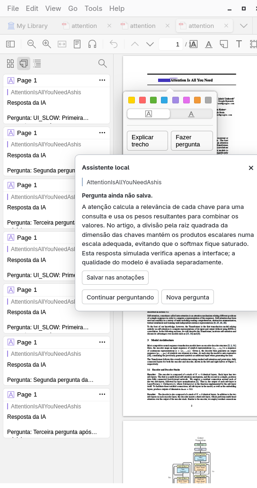
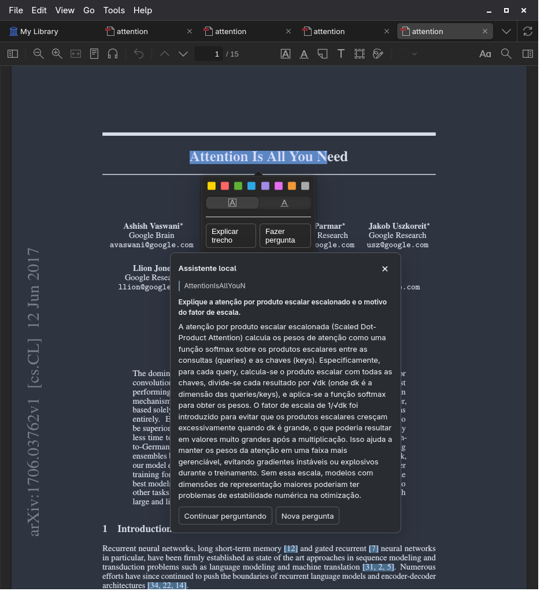

# Assistente local de leitura para Zotero

Plugin pessoal para **Zotero 10.0.3–10.0.x**. Selecione texto no leitor de PDF e escolha **Explicar trecho** ou **Fazer pergunta**. A resposta aparece num popup junto à seleção; **Continuar perguntando** mantém somente aquela conversa. Fechar o popup ou escolher **Nova pergunta** descarta o histórico.

Cada pedido envia o **texto extraído de todas as páginas**, incluindo referências e legendas, ao modelo local escolhido: **LFM2.5-2.6B** ou **LFM2.5-8B-A1B**. O plugin não cria anotações obrigatórias, não usa serviços externos e não persiste conversas automaticamente.

Cada resposta concluída oferece **Salvar nas anotações**. A ação cria um destaque roxo no trecho original, com a pergunta e somente aquela resposta no comentário. A anotação aparece na aba nativa de anotações do PDF e permanece após fechar o popup. Você pode salvar respostas anteriores de uma continuação; cada uma tem seu próprio botão. Após salvar, o botão mostra **Salvo nas anotações**. Falhas permitem tentar novamente, e PDFs em bibliotecas sem permissão de edição recebem uma mensagem explicativa.

As respostas exibem **Markdown formatado**: títulos (`##`), negrito (`**`), itálico, listas, tabelas e código. Também exibem **LaTeX formatado**, com índices, frações, raízes e limites de somatórios/produtos. O plugin empacota markdown-it e KaTeX e usa MathML nativo do Zotero, sem baixar fontes ou scripts durante o uso. Aceita `\(...\)`, `\[...\]`, `$...$` e `$$...$$`, inclusive a variante com barras duplicadas que o modelo às vezes produz. Fórmulas incompletas durante o streaming ou com sintaxe inválida permanecem como texto. HTML gerado pelo modelo não é executado, e imagens/links no Markdown não carregam recursos externos.

Veja [o teste visual de fórmulas no popup](docs/images/native-math.png), com resposta simulada.

Nas anotações salvas, o plugin apresenta a mesma formatação enquanto está ativo. Ao editar o comentário, aparece o Markdown e LaTeX originais; o HTML gerado nunca é salvo. Comentários antigos com sintaxe válida também ganham a visualização formatada. Expressões já convertidas em texto simples, sem índices ou delimitadores, não podem ser reconstruídas automaticamente: faça uma nova pergunta para obter uma fórmula em LaTeX.

Interface com respostas simuladas no perfil de teste:



## Obter o projeto

O código está em [felipebocajr/zotero-reader-local-ai](https://github.com/felipebocajr/zotero-reader-local-ai). Baixe o `.xpi` instalável na [versão v0.1.0](https://github.com/felipebocajr/zotero-reader-local-ai/releases/tag/v0.1.0) e mantenha uma cópia do projeto para preparar e iniciar o servidor local:

```bash
git clone https://github.com/felipebocajr/zotero-reader-local-ai.git
cd zotero-reader-local-ai
python3 scripts/setup_runtime.py --backend auto --precision Q4_K_M
```

Pesos, binários, PDFs de teste e perfis locais não fazem parte do Git. O checkpoint e os downloads verificáveis ficam registrados em `runtime.lock.json`; os resultados pequenos dos experimentos estão versionados em `experiments/`. Para gerar o XPI a partir do código, veja [Desenvolvimento](#desenvolvimento).

## Usar neste computador

Use o XPI baixado da versão publicada ou o arquivo `dist/reader-local-ai-0.1.0.xpi` gerado pelo build. Após preparar o runtime, os binários e modelos ficam em `.runtime/`.

1. No Zotero, abra **Ferramentas → Plugins**, use a engrenagem → **Instalar plugin de arquivo** e escolha o XPI.
2. Abra **Configurações → Assistente local**, clique em **Escolher pasta…** e selecione a pasta deste projeto, que contém `scripts/serve.py` e `.runtime`.
3. Escolha o modelo e clique em **Iniciar servidor**. Aguarde o status **Pronto**. **Parar** libera a memória; **Reiniciar** aplica uma troca de modelo ou contexto.
4. Para dispensar esse clique nas próximas sessões, marque **Iniciar automaticamente ao abrir o Zotero** e salve. A opção começa desativada.
5. Abra um PDF, selecione um trecho e escolha uma das duas ações.

O servidor iniciado pelo plugin é encerrado ao desativá-lo ou fechar o Zotero. Um servidor iniciado em outro aplicativo continua independente: o plugin o reconhece e não oferece encerrá-lo. Você também pode continuar usando `python3 scripts/serve.py` no terminal.

O modo padrão tenta colocar **todas as camadas na GPU**. Se faltar VRAM, ajusta a distribuição entre **GPU e CPU**; usa somente CPU se a GPU estiver indisponível ou o modo compartilhado também falhar por memória. O contexto, os pesos e o cache K/V em f16 permanecem iguais durante o fallback. Todas as camadas na GPU não significam utilização constante de 100%: tokenização e controle do processo ainda usam CPU.

Para forçar apenas CPU:

```bash
python3 scripts/serve.py --backend cpu
```

CPU funciona, mas papers longos podem levar vários minutos. O tempo limite inicial é de dez minutos. Um servidor iniciado no terminal é encerrado com `Ctrl+C`; o supervisor também encerra seu processo filho. Se faltar VRAM durante uma resposta, o pedido será interrompido: espere o novo backend ficar pronto e repita a pergunta. Veja [os modos e o diagnóstico do runtime](docs/runtime.md).

As configurações ficam em **Configurações → Assistente local**: endereço `http://127.0.0.1:8080`, seletor de modelo, contexto 32.768 tokens e reserva de geração 4.096 tokens. O 2.6B continua como padrão. Expanda **Contexto e conexão** para ajustar esses valores. **Reiniciar** aplica o contexto ao servidor gerenciado pelo Zotero; num servidor externo, ajuste também `--context` no launcher. O consumo de memória aumenta mesmo com pesos Q4, porque o cache K/V permanece em f16.

Em **Idioma das respostas**, escolha **Português (Brasil)** (padrão) ou **Inglês** e clique em **Salvar configurações**. A preferência vale para o próximo pedido, inclusive numa conversa aberta, sem reiniciar o servidor. O idioma do artigo ou da pergunta não muda essa preferência; um pedido explícito de outro idioma na pergunta tem prioridade. Respostas já geradas e anotações salvas mantêm seu texto original. O plugin reforça o idioma no início das instruções e após cada pergunta, depois do contexto completo.

Veja [o seletor nativo de idioma](docs/images/native-language.png).

Para usar a opção maior, prepare seus pesos uma vez:

```bash
python3 scripts/setup_runtime.py --model lfm2.5-8b-a1b
```

Escolha o 8B-A1B nas preferências e clique em **Reiniciar** (ou **Iniciar servidor**, se estiver parado). Para voltar ao 2.6B, selecione-o e reinicie. Salvar a seleção não interrompe uma geração. Se o servidor foi iniciado no terminal, encerre-o com `Ctrl+C` antes de trocar ou assumir o controle pelo Zotero. O plugin verifica o modelo carregado antes de enviar o artigo.

O [LFM2.5-8B-A1B oficial](https://huggingface.co/LiquidAI/LFM2.5-8B-A1B) possui 8,3 bilhões de parâmetros totais e 1,5 bilhão ativos por token. Seus pesos Q4 ocupam cerca de 5,16 GB, comparados a 1,67 GB do 2.6B; o consumo total de memória é maior. Seu limite de contexto é 128.000 tokens, enquanto o 2.6B suporta 131.072. É uma opção de maior capacidade, cuja qualidade no conjunto de artigos ainda precisa de comparação; a avaliação de precisões existente continua sendo do 2.6B.

## Preparar em outra instalação Linux x86_64

Necessário: Python 3.12+, Zotero compatível e espaço para os modelos. CUDA requer driver NVIDIA compatível com o binário CUDA 12.8. O suporte a Windows/macOS ainda não foi validado.

```bash
python3 scripts/setup_runtime.py --backend auto --precision Q4_K_M
```

O instalador prepara os binários CUDA, suas bibliotecas e o binário CPU para permitir fallback. Baixa versões fixadas em [`runtime.lock.json`](runtime.lock.json) e verifica SHA-256 antes de usar os arquivos. Depois, instale o XPI e escolha essa pasta nas preferências. Downloads precisam de internet; a leitura, o início pelo Zotero e a inferência funcionam offline. O plugin não instala drivers nem baixa pesos. Uma instalação exclusivamente CPU pode usar `--backend cpu` na preparação e iniciar `python3 scripts/serve.py --backend cpu` no terminal.

O manifest exige uma URL HTTPS de atualização. Este protótipo aponta para `https://127.0.0.1/reader-local-ai/updates.json`, sem servidor de atualização; **as atualizações são manuais**. Nenhum serviço externo recebe pedidos de atualização do plugin.

## Limites e erros esperados

- PDFs escaneados sem texto exigem OCR, fora desta versão. Fórmulas e tabelas podem perder estrutura na extração; gráficos não são interpretados visualmente.
- O limite efetivo é o menor entre o contexto do servidor e a configuração do plugin. O template inteiro é tokenizado pelo próprio runtime antes da geração. Se artigo + conversa + reserva não couberem, o plugin avisa e não corta o PDF.
- Apenas um pedido pode estar em andamento. Cancelar ou fechar aborta a requisição; uma extração já iniciada pelo worker do Zotero pode terminar em segundo plano, mas não segue para inferência.
- O raciocínio do modelo não aparece no popup nem entra no histórico. Uma resposta interrompida ou sem conclusão é tratada como erro.
- As respostas são auxiliares de leitura. A [avaliação de 135 gerações](experiments/report.md) encontrou erros de conceitos/fórmulas nas três precisões e cumprimento irregular da extensão pedida. Texto completo no contexto não garante precisão científica.

## Validação

O XPI de distribuição foi instalado e ativado no Zotero 10.0.3 em perfil isolado. A interface passou por 39 verificações nativas com respostas simuladas, incluindo seleção de modelo/idioma e rejeição de um servidor com alias diferente. Os 52 testes TypeScript cobrem contexto, cache, streaming, ciclo da conversa, idioma por pedido, renderização de Markdown e LaTeX, gravação de respostas escolhidas e ciclo de vida do servidor. O 2.6B real respondeu a quatro pedidos em três PDFs, incluindo continuação e pergunta sem resposta no artigo.

O salvamento passou por [21 verificações nativas](experiments/results/native-annotations.json), incluindo teclado, permissões, novas tentativas e persistência após reiniciar o Zotero. A integridade e a ativação do pacote atualizado estão em [annotation-build-validation.json](experiments/results/annotation-build-validation.json).

A formatação Markdown passou por [17 verificações nativas](experiments/results/native-markdown.json), incluindo streaming, combinação com MathML, texto original na anotação e persistência após reiniciar o Zotero. Veja [a validação do pacote atualizado](experiments/markdown-validation.md).

A renderização matemática passou por [24 verificações nativas](experiments/results/native-math.json), incluindo streaming, fonte LaTeX preservada, edição de comentários e remoção das visualizações ao desativar. Uma [resposta real](experiments/results/math-model-smoke.json) produziu nove expressões renderizáveis e manteve a contagem prévia de 10.137 tokens igual à do runtime. O pacote com KaTeX e sua ativação estão em [math-build-validation.json](experiments/results/math-build-validation.json). Esses testes validam a formatação, não a correção científica das equações.

O perfil Q4 com todas as camadas na RTX 3070 completou esses quatro pedidos em aproximadamente 3–9 segundos. Esse perfil de uso é separado da comparação experimental, que manteve 24 camadas na GPU para todas as precisões. Evidências ficam em [`experiments/results/`](experiments/results/).

O novo modo automático foi validado separadamente com inferência real: Q4 na GPU inteira, F16 após falta de VRAM com 23/31 camadas na GPU e o restante em CPU, e Q4 em CPU com CUDA indisponível. Os dois testes com artigo completo preservaram a contagem de tokens e o contexto; os 18 testes de runtime/instalação cobrem também a ordem do fallback, identidade do modelo, substituição segura de bibliotecas e encerramento do launcher gerenciado. Veja [a evidência do fallback](experiments/runtime-fallback-validation.md).

O 8B-A1B Q4 também foi [validado com inferência real](experiments/lfm8b-validation.md): artigo completo de 15 páginas, 10.038 tokens conferidos contra o servidor e cerca de 19 segundos até concluir a resposta. Com outros aplicativos ocupando a RTX 3070, o supervisor passou de falta de VRAM para GPU/CPU, mantendo 32.768 tokens e K/V f16. O popup real passou por oito verificações, incluindo continuação e escolha persistente de modelo. Esses tempos não são uma comparação controlada de modelos, e Q8/F16 do 8B-A1B ainda não foram executados.

O controle do servidor pela interface passou por [20 verificações nativas](experiments/results/native-runtime.json): ambos os modelos responderam pelo popup, o 8B passou de falta de VRAM para GPU/CPU e os botões encerraram somente os processos próprios. O [teste de reinício integral](experiments/results/native-runtime-restart.json) verifica encerramento ao fechar o Zotero e início automático na abertura seguinte. Veja [os comandos e evidências](experiments/native-runtime-validation.md).

A preferência de idioma passou por [28 verificações nativas](experiments/results/native-languages.json): os dois modelos responderam em português, inglês e novamente português na mesma conversa, conforme a configuração, mesmo quando a pergunta estava em outro idioma. Uma geração adicional confirmou 10.257 tokens no preflight e no runtime. Veja [a validação e seus limites](experiments/language-validation.md).

Captura do popup no teste com o modelo real; o conteúdo gerado não é uma resposta de referência:



## Desenvolvimento

Necessário Node.js 22.18+ e npm. Não é preciso Node para usar o XPI pronto.

```bash
npm ci
npm run check
npm test
npm run test:runtime
npm run build
```

O build gera um XPI reproduzível, sem dependências npm em execução. A extração interna está isolada em `src/zotero-paper.ts` e a gravação nativa em `src/zotero-annotations.ts`; o resto separa contexto, cliente HTTP, streaming, sessão e interface.

Veja [`docs/development.md`](docs/development.md) para o perfil isolado e os testes nativos, e [`experiments/README.md`](experiments/README.md) para reproduzir a comparação de precisões. As decisões permanentes ficam em [`AGENTS.md`](AGENTS.md).
