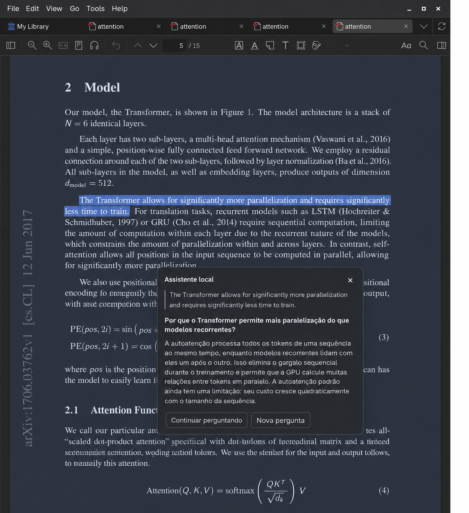

# Assistente local de leitura para Zotero

[English](README.md) | **Português (Brasil)**

Extensão do Zotero que ajuda a compreender trechos de PDFs e responder a perguntas sobre artigos usando modelos de linguagem executados localmente.



## Funcionalidades

- Explica trechos selecionados e responde a perguntas sobre o PDF.
- Exibe a assistência junto ao texto e permite salvar respostas úteis como anotações do Zotero.
- Formata Markdown e expressões matemáticas.
- As respostas seguem automaticamente o idioma de cada pergunta, sem uma configuração separada de idioma.
- Por padrão, usa RAG local: envia ao modelo apenas os trechos mais relevantes do artigo, com Qwen3-Embedding-0.6B. O modo **Artigo completo** continua disponível.
- A inferência é local por padrão; um provedor Groq opcional pode ser configurado com sua própria chave de API.
- A inferência é local, e as conversas não são salvas automaticamente.

## Compatibilidade

- Zotero 10.0.3–10.0.x. A versão estável atual, 10.0.6, e o piso 10.0.3 têm evidência nativa de ativação, interface e runtime gerenciado no Linux.
- Runtime integrado e controles do servidor validados em Linux x86_64 com Python 3.12 ou superior. O suporte a Windows 10 22H2 e Windows 11 x64 está implementado, mas a aceitação nativa no Windows ainda está pendente. macOS, Windows ARM64 e Windows 32 bits não são suportados.
- GPU NVIDIA é opcional. No Linux, usa CUDA 12.8; no Windows, CUDA 12.4 com driver 551.61 ou superior. O modo automático pode usar a GPU, compartilhar o trabalho entre GPU e CPU ou recorrer somente à CPU.

## Instalação

1. Baixe o pacote `.xpi` na página de [Releases](https://github.com/felipebocajr/zotero-reader-local-ai/releases).
2. Clone o projeto e prepare o runtime, o modelo de chat padrão (LFM2.5-8B-A1B, Q4_K_M) e o modelo de embeddings (Qwen3-Embedding-0.6B, Q8_0):

   Linux:

   ```bash
   git clone https://github.com/felipebocajr/zotero-reader-local-ai.git
   cd zotero-reader-local-ai
   python3 scripts/setup_runtime.py --backend auto --precision Q4_K_M
   ```

   Windows (PowerShell, Python 3.12+ de 64 bits):

   ```powershell
   git clone https://github.com/felipebocajr/zotero-reader-local-ai.git
   cd zotero-reader-local-ai
   py -3 scripts\setup_runtime.py --backend auto --precision Q4_K_M
   ```

   Esta etapa baixa os arquivos necessários, incluindo o modelo de embeddings de 639 MB, e requer internet e espaço em disco. Depois da preparação, a inferência pode funcionar offline. Use `--backend cpu` para não baixar o runtime CUDA ao iniciar o servidor manualmente com `--backend cpu`; o controle pela interface espera os runtimes automáticos de GPU e CPU.

3. No Zotero, abra **Ferramentas → Plugins**, escolha **Instalar plugin de arquivo** no menu de engrenagem e selecione o `.xpi`.
4. Em **Configurações → Assistente local**, escolha a pasta clonada e clique em **Iniciar servidor**. Quando o status indicar **Pronto**, abra um PDF, selecione um trecho e escolha **Explicar trecho** ou **Fazer pergunta**. A primeira explicação é breve; depois dela, escolha **Explicar com mais detalhes** para aprofundar. Use **Expandir** no cabeçalho do popup para aumentar o tamanho e **Restaurar** para voltar ao padrão; arraste o cabeçalho para mover o popup e o canto inferior direito para redimensionar livremente.

O modelo padrão é o LFM2.5-8B-A1B. Para usar o LFM3-1.7B ou configurar o runtime, consulte o [guia de runtime](docs/runtime.md). O LFM2.5-2.6B legado permanece apenas para o benchmark entregue e não aparece no plugin. As atualizações do plugin são manuais.

### Provedores

- **Servidor local (padrão):** usa o `llama-server` deste projeto, com contagem exata do template e inferência offline depois da preparação.
- **Groq (API):** usa sua própria chave `gsk_...`, o modelo escolhido e o contexto configurado. No modo padrão, somente os trechos recuperados, o trecho selecionado e a pergunta são enviados ao Groq pela internet; os embeddings continuam locais. O artigo completo só é enviado se você escolher **Artigo completo** em **Contexto enviado**. Neste protótipo, a chave fica salva nas preferências do Zotero em texto puro; use uma chave com limite de uso.

Para trocar de provedor, abra **Configurações → Assistente local**, escolha **Groq (API)**, cole a chave e pressione **Enter** para buscar os modelos. Escolha um modelo na lista e clique em **Salvar configurações**. Não há servidor local para iniciar nesse modo.

## Privacidade e limitações

Por padrão, a inferência e os embeddings acontecem no dispositivo. Se você selecionar **Groq (API)**, somente os trechos recuperados, o trecho selecionado e a pergunta serão enviados ao Groq; isso só acontece depois dessa escolha explícita. O artigo completo só vai para o Groq no modo **Artigo completo**, também escolhido explicitamente. A chave fica nas preferências do Zotero em texto puro neste protótipo. A preparação inicial baixa o runtime e os arquivos dos modelos. PDFs escaneados sem texto selecionável precisam de OCR, que não está incluído. As respostas podem conter erros; consulte a [avaliação e seus limites](experiments/report.md).

## Desenvolvimento

Requer Node.js 22.18 ou superior. Para conferir o código e gerar o pacote:

```bash
npm ci
npm run check
npm test
npm run test:runtime
npm run build
```

O XPI é gerado em `dist/`. Consulte os guias de [desenvolvimento e testes nativos](docs/development.md), [runtime](docs/runtime.md) e [experimentos](experiments/README.md).

## Licença

Este projeto ainda não especifica uma licença.
