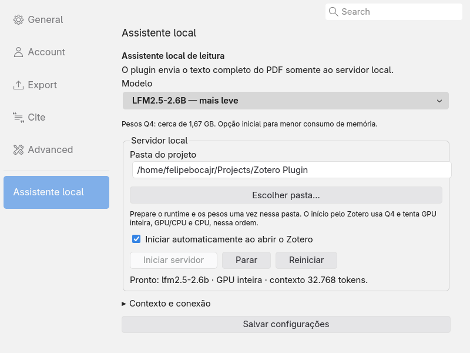

# Servidor controlado pela interface do Zotero

Validação em Zotero 10.0.3, Linux x86_64, RTX 3070 de 8 GiB. Instalação, abertura de PDFs e alterações de preferências ocorreram somente no perfil e biblioteca isolados do projeto. Outros aplicativos continuaram usando a GPU.

## Resultado

- **44 testes TypeScript**: inclui propriedade do processo, proteção de servidores externos, início duplicado, cancelamento de uma criação pendente, reinício explícito e estados de fallback.
- **18 testes Python**: política de GPU/CPU, identidade do modelo/cache/contexto, isolamento das precisões experimentais, EOF do controle e saída do processo pai.
- **35 verificações nativas da interface existente**: preferências, seleção, teclado, popups, streaming, erros, conversas e limpeza.
- **20 verificações nativas de controle do servidor**: início pelo botão, pasta inválida, reinício entre modelos, inferência real no popup, parada, servidor externo preservado e início automático ao reabilitar.
- **8 verificações após reiniciar o Zotero inteiro**: os PIDs antigos desapareceram; o novo processo iniciou automaticamente com a opção persistida; restaurar o teste encerrou o novo servidor.
- **3 verificações de fechamento da janela de configurações**: uma consulta de status pendente não reagendou timers nem acessou uma janela Gecko destruída.

As respostas reais do teste de botões usaram o PDF completo de Attention Is All You Need, de 15 páginas. O 2.6B executou em GPU inteira e concluiu em cerca de 9,2 segundos. O 8B-A1B esgotou a VRAM na primeira tentativa, carregou com GPU/CPU e concluiu em cerca de 15,3 segundos, preservando 32.768 tokens e K/V f16. Os tempos incluem a geração, não o carregamento do modelo, e não constituem comparação controlada de qualidade ou velocidade.

Após o início automático, um teste adicional no servidor gerenciado conferiu **10.132 tokens** tanto na contagem prévia quanto em `timings.prompt_n`, com todas as 15 páginas. Concluiu em aproximadamente **6,5 segundos**. O PID do servidor apareceu no NVIDIA-SMI com **2.396 MiB** de VRAM alocada durante esse teste. Esse número é uma amostra, não um pico de consumo.

As respostas são evidência de funcionamento, não referências científicas. Há alegações incorretas/não sustentadas nas respostas registradas; a avaliação anterior de qualidade continua aplicável. O controle do servidor não muda o modelo nem a política de contexto.

## Evidências

| Artefato | Conteúdo |
|---|---|
| [native-runtime.json](results/native-runtime.json) | Botões nativos, processos próprios/externos, ambos os modelos e respostas reais |
| [native-runtime-restart.json](results/native-runtime-restart.json) | Encerramento e início automático num processo Zotero novo |
| [native-runtime-pane.json](results/native-runtime-pane.json) | Resposta de status após fechar a janela |
| [native-managed-smoke.json](results/native-managed-smoke.json) | Artigo inteiro, tokens, tempos e resposta após início automático |
| [native-managed-gpu.json](results/native-managed-gpu.json) | VRAM do PID do servidor gerenciado |
| [native-runtime-build-validation.json](results/native-runtime-build-validation.json) | Integridade do XPI, correspondência com o instalado e ativação pelo AddonManager |

## Reproduzir

Prepare Q4 dos dois modelos e o perfil isolado, instale o XPI de desenvolvimento e inicie o servidor simulado em 18080. Termine `scripts/zotero-ui-tests.js` antes de executar `scripts/zotero-runtime-tests.js` pelo debugger. O teste real usa 18094 e restaura preferências ao terminar.

Para validar uma abertura completa, instale o XPI de distribuição e execute `scripts/zotero-runtime-restart-prepare.js`. Reabra somente o mesmo perfil isolado, espere o modelo e execute `scripts/zotero-runtime-restart-check.js`. O script restaura o `user.js` original e encerra o servidor. `scripts/zotero-runtime-pane-tests.js` reproduz a resposta tardia de status sem iniciar inferência. Os comandos e guardas estão em [development.md](../docs/development.md).

O início nativo usa a pasta escolhida, Python 3 do sistema, Q4 e colocação automática. Não baixa pesos nem instala drivers; o runtime precisa ser preparado uma vez. Distribuição fixa e F16/Q8 permanecem disponíveis pelo terminal. A comparação de precisões entregue não foi alterada.
